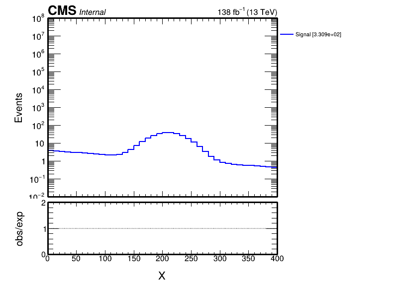
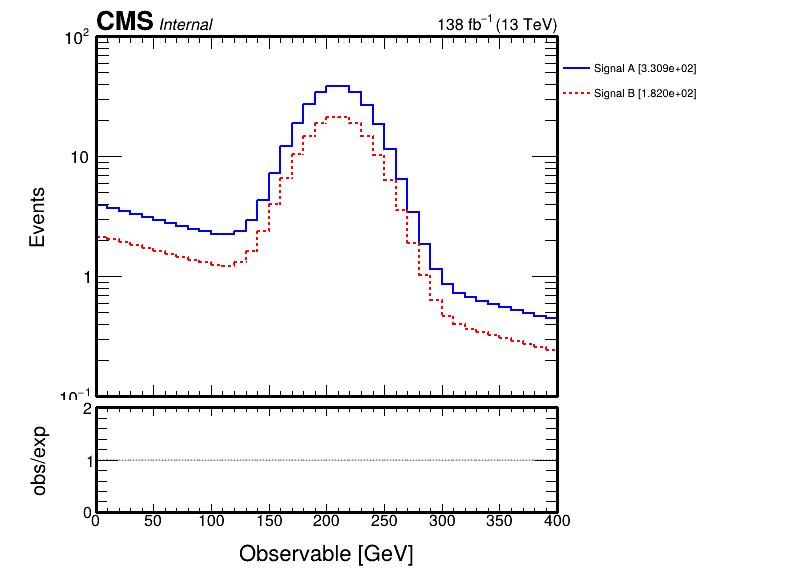
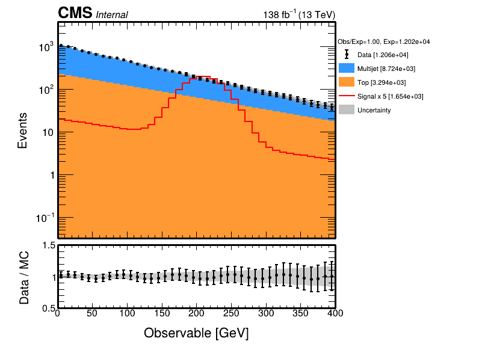
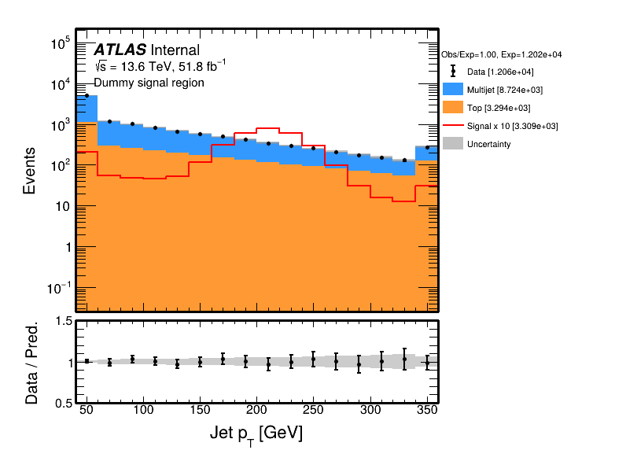
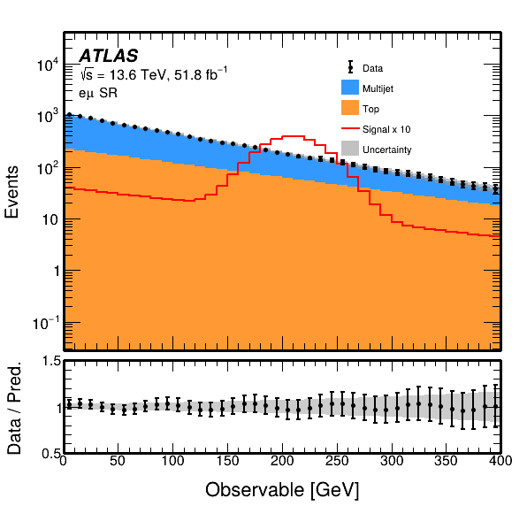
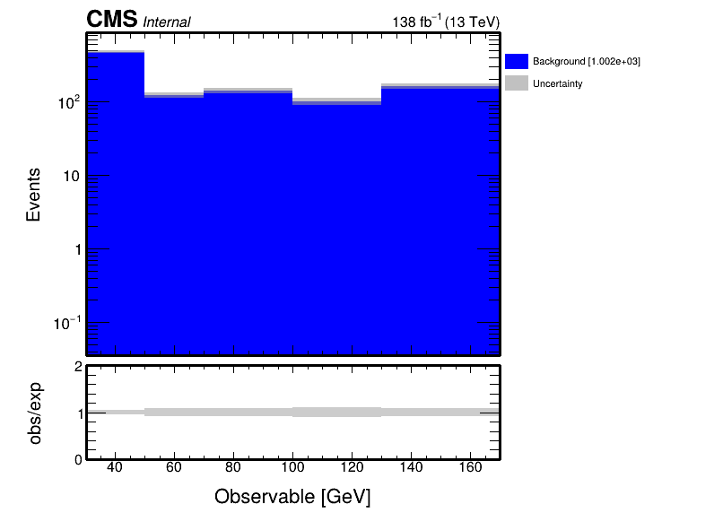
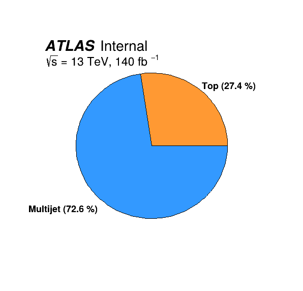

# PyHEPPlotLib

A lightweight Python plotting library built on top of **ROOT**, designed for high-energy physics (HEP) analysis.

Supports stacked histograms, signal overlays, data/MC comparisons, ratio plots, uncertainty bands, pie charts, and CMS/ATLAS publication styles.

---

## Plot Gallery

The following examples demonstrate the plotting functionality, from minimal histograms to full analysis-style figures.

<table>
<tr>
<td width="50%" align="center">
  <a href="outputs/01_minimal.png">
    
  </a>
  <br>
  <b>01 — Minimal ROOT Histogram</b>
  <br>
  Basic histogram plotting using <code>plt.hist(h)</code>.
</td>
<td width="50%" align="center">
  <a href="outputs/02_overlay.png">
    
  </a>
  <br>
  <b>02 — Histogram Overlay</b>
  <br>
  Multiple histograms, line styles, axis ranges, and logarithmic scales.
</td>
</tr>

<tr>
<td width="50%" align="center">
  <a href="outputs/03_stack_data_ratio.png">
    
  </a>
  <br>
  <b>03 — Stack + Data/MC Ratio</b>
  <br>
  Stacked backgrounds, scaled signals, observed data, and MC uncertainty.
</td>
<td width="50%" align="center">
  <a href="outputs/04_atlas_analysis.png">
    
  </a>
  <br>
  <b>04 — ATLAS Analysis Style</b>
  <br>
  ATLAS labels, luminosity, custom legends, captions, and ratio ranges.
</td>
</tr>

<tr>
<td width="50%" align="center">
  <a href="outputs/05_publication.png">
    
  </a>
  <br>
  <b>05 — Publication Style</b>
  <br>
  Clean publication-style figures with statistical yields hidden.
</td>
<td width="50%" align="center">
  <a href="outputs/06_rebin_overflow.png">
    
  </a>
  <br>
  <b>06 — Rebinning and Overflow</b>
  <br>
  Custom X-ranges, overflow folding, truncation, and variable binning.
</td>
</tr>

<tr>
  <td width="50%" align="center">
    <a href="outputs/03_pietest_atlas.png">
      
    </a>
    <br>
    <b>07 — ATLAS Pie Chart</b>
    <br>
    Background composition visualized as a pie chart.
  </td>
  <td width="50%"></td>
</tr>
</table>

---

## Quick Start

### Generate the Plot Gallery

Run from the repository root:

```bash
python tests/test_gallery.py
```

Generated PNG figures are saved in the configured output directory.

### Run Regression Tests

```bash
pytest -q
```

---

## Examples

### 01 — Minimal ROOT Histogram

Verify the minimal plotting API:

```python
plt.hist(h)
```

### 02 — Histogram Overlay

Demonstrates:

- Multiple non-stacked histograms
- Different line styles
- Custom X/Y axis ranges
- Legend positioning
- Logarithmic scaling

### 03 — Analysis Stack + Data/MC Ratio

Demonstrates:

- Stacked background histograms
- Signal overlays with scaling
- Observed data
- MC statistical uncertainty band
- Data/MC ratio panel

### 04 — ATLAS Analysis Style

Demonstrates:

- Persistent global ATLAS configuration
- ATLAS/Internal labels
- Luminosity and collision energy
- Additional plot captions
- Custom legend positioning
- Axis ranges and rebinning

### 05 — Publication Style

Demonstrates publication-oriented plotting with statistical yields removed from the legend.

### 06 — X-Range, Overflow and Rebinning

Exercises histogram transformations that must not accidentally modify the original ROOT histograms:

- Custom X-axis ranges
- Underflow and overflow handling
- Histogram truncation
- Variable-width rebinning
- Histogram content preservation

### 07 — ATLAS Pie Chart

Demonstrates pie-chart visualization of background contributions.


---

## Regression Tests

The `tests/test_core.py` suite checks the following behavior:

| Test | Expected behavior |
|---|---|
| Independent Plotters | Multiple `Plotter` instances maintain independent histogram states |
| Histogram cloning | Input histograms are cloned and detached before plotting |
| Repeated drawing | Calling `Draw()` repeatedly does not cumulatively modify source histograms |
| Rebin reversibility | Changing rebinning between draws starts from clean histogram clones |
| Persistent style | Global `plt.style(...)` settings persist across newly created figures |
| Overflow folding | Underflow/overflow contents are correctly handled for custom X-ranges |
| Truncated X-range | Truncation retains only the intended subrange content |

### Histogram Safety

The library is designed to prevent accidental modifications to source ROOT histograms.

In particular:

- Plotting operations work on independent histogram clones.
- Repeated drawing should not modify histogram contents.
- Different rebinning configurations should not accumulate changes across draws.
- X-range handling and histogram truncation are tested separately.

---

## Development

To generate all example plots and run the regression suite:

```bash
python tests/test_gallery.py
pytest -q
```

The gallery provides visual examples, while the regression tests check plotting behavior and histogram state preservation.